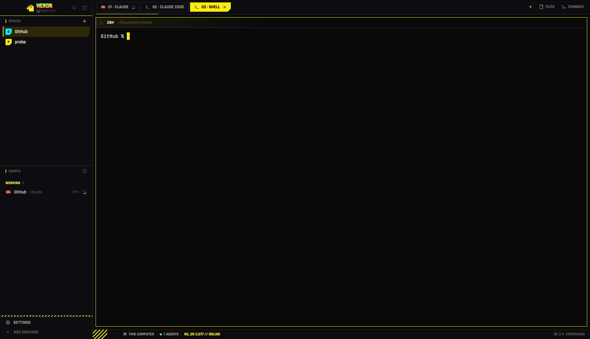

# Herdr Cyberpunk Theme

Cyberpunk 2077 theme for [Herdr](https://herdr.dev), in two parts: the Night City layout for the desktop app, and a matching theme for the Herdr TUI (yellow on near-black, with a plugin that shows each coding agent as its logo instead of its name).

## What's included

| Path | Purpose |
| --- | --- |
| `app/` | Night City layout for the Herdr desktop app, laid out like a Herdr home: `layouts/night-city.*`, the `cyberpunk-2077` theme, seven `nc-*` mods, two `nc-*` sounds, `install.sh`, tests and [`RECIPE.md`](app/RECIPE.md). See [App layout (Night City)](#app-layout-night-city). |
| `config.toml` | Full Herdr config: `[theme.custom]` palette (yellow `#FCEE0A` on near-black, cyan `#00F0FF` branches, red `#FF003C` blocked), symbol status indicators, pane frames labeled with agent logos, a `NIGHT CITY // 2077 // HH:MM` tab-bar readout, one-line agent rows with a single yellow glyph per agent (no per-agent brand-color table), and space rows with the workspace in yellow and the branch in cyan. |
| `plugins/agent-icons/` | `local.agent-icons` plugin. When Herdr detects an agent (and at server startup) it sets the agent's display name to a Nerd Font logo with `herdr pane report-metadata --display-agent`, guarded by `--agent` so the logo goes away when that agent exits. |

## App layout (Night City)

Night City redraws the Herdr desktop app as a Cyberpunk 2077 menu screen:
neon yellow `#FCEE0A` on near-black, with cyan and red as accents and cut
corners on every active element. It includes a ram mark with a glitched
wordmark, uppercase Rajdhani type, hazard stripes, and a red `NEEDS YOU` tag
that blinks when an agent needs you. It's a layout, a theme
(`cyberpunk-2077`), seven cloned `nc-*` mods and two sounds. `app/` is laid
out like a Herdr home, so it's also a herdr.dev layout folder (topic
`herdr-layout`). [`app/RECIPE.md`](app/RECIPE.md) describes every region,
size and color.



Install (macOS, with the Herdr app; built against `herdr-app 0.1.11`):

```sh
git clone https://github.com/liveinknewgithub/herdr-cyberpunk-theme.git
cd herdr-cyberpunk-theme
app/install.sh
```

The installer:
- copies `layouts/night-city.*`, `themes/cyberpunk-2077.json`, `mods/nc-*`
  and `sounds/nc-*.mp3` into `~/.config/herdr-app`
- backs up `settings.json` to `settings.json.bak-night-city`
- sets `theme`, `sounds.done` and `sounds.blocked`
- runs `herdr-app check` on each mod
- if the app is open, gives `main` the `cyberpunk-2077` theme and switches
  to `night-city`

It never overwrites shipped files. Flags:

- `--force`: replace `night-city*`, `cyberpunk-2077*` and `nc-*` files
  already installed.
- `--home <dir>`: install into another Herdr app home (default
  `$HERDR_APP_HOME` or `~/.config/herdr-app`).
- `--no-app`: copy files only, without looking for, checking with or driving
  `herdr-app`.

Go back: `⌘⇧L` cycles layouts, or run `herdr-app do layout.switch --name main`.
Uninstall: `app/install.sh --uninstall` removes those files and puts the
three `settings.json` keys back from the backup. With the app open it also
gives `main` back the theme it showed before the install (recorded in
`night-city.uninstall.json`); with the app closed it prints the
`herdr-app do app.theme --name …` line to run once Herdr is open on `main`.

Sounds: `app/sounds/nc-done.mp3` and `nc-blocked.mp3` are synthesized by
`app/sounds/make_sounds.py`. They replace the done and blocked alerts
through `settings.json` (`sounds.done`, `sounds.blocked`), and you can play
them from Settings → Alerts.

Font: [Rajdhani](https://github.com/google/fonts/tree/main/ofl/rajdhani)
(Medium, SemiBold, Bold) ships in `app/mods/nc-chrome/fonts/` under the SIL
Open Font License 1.1 (`OFL.txt`). Terminals keep your own font.

Tests:

```sh
node --test 'app/tests/*.test.js'
python3 -I -m unittest discover -s app/tests -p 'test_*.py' -v
app/tests/test_install.sh
```

## TUI theme

The Herdr TUI uses the same palette as the app layout: yellow `#FCEE0A` on near-black, cyan `#00F0FF` branches and red `#FF003C` for blocked.

### Requirements

- Herdr 0.9.5 or newer.
- A Nerd Font in your terminal. The Claude (`U+EC82`) and OpenAI/Codex (`U+EC81`) logos need Nerd Fonts 3.5 or newer, for example [Symbols Nerd Font](https://github.com/ryanoasis/nerd-fonts/releases).
- `jq` (included with recent macOS).

### Install

```sh
git clone https://github.com/liveinknewgithub/herdr-cyberpunk-theme.git
cd herdr-cyberpunk-theme
cp ~/.config/herdr/config.toml ~/.config/herdr/config.toml.bak   # keep your current config
cp config.toml ~/.config/herdr/config.toml
herdr plugin link "$PWD/plugins/agent-icons"
herdr plugin action invoke local.agent-icons.sync                 # label agents already running
herdr server reload-config
```

`config.toml` mentions `~/.config/herdr/local-plugins/agent-icons`, where the plugin lives on the original machine; `herdr plugin link` works from any path.

### Customize

- Icons: edit the `case` block in `plugins/agent-icons/agent-icons.sh`. Each line names the Nerd Font glyph and codepoint; agents without a mapping keep their text name.
- Agent glyph color: the `fg` in `[ui.sidebar.agents]` in `config.toml`. Add a `[ui.sidebar.agents.rows_by_agent]` table if you want per-agent colors.
- Pane frames: `pane_borders = "always"` frames every pane; `"auto"` frames only splits.

Matching terminal colors: [ghostty-cyberpunk-theme](https://github.com/liveinknewgithub/ghostty-cyberpunk-theme).
