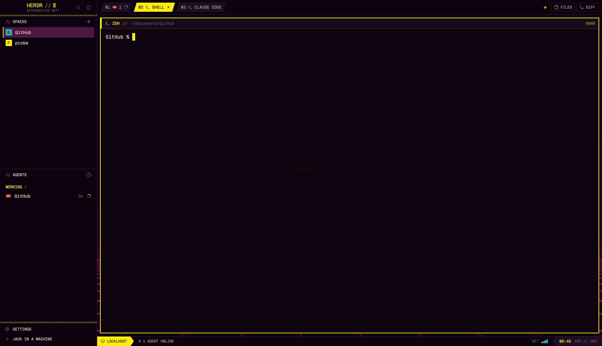

# Night City

The Herdr window redrawn as a Cyberpunk 2077 netrunner terminal. Neon yellow
`#FCEE0A` and hot pink `#FF3D8B` sit on deep plum, over a synthwave backdrop:
a striped sun, a magenta horizon and a perspective grid that show in the gaps
between panes and faintly through the terminals. Type is Geist Mono, which
Herdr bundles. Every section header is `// NAME`, the active tab is a yellow
parallelogram, and thin hazard stripes sit under the brand block, above the
footer and in the pane header. The brand reads `HERDR // ▮` with a blinking
cursor block over `NETRUNNER/OS 2077`. Terminals keep the person's own
terminal font.



## What you see

Left to right: a 268 px sidebar, then the work column. A 1 px `#36122C`
divider runs between them. The window has no system title bar, and the macOS
traffic lights sit at (12, 16).

**Colors** (theme `cyberpunk-2077`): canvas `#12040F`, chrome (sidebar, tab
bar, status bar) `#0C0510`, popover `#120A17`, surface `#160B19`, raised
`#1D1022`, hover `#26142C`, selected (plum) `#4C1743`, border `#36122C`, input
`#5A2A50`. Text is foreground cream `#EBD9BC`, muted `#B49A9C` or dim
`#6A5868`. Accent and solid are `#FCEE0A`, with `#0C0510` text on them. Hot
pink `#FF3D8B` (ANSI 5) marks every `//`, and cyan `#3BD0CC` (ANSI 6) is the
NET meter and the done color. Status colors: working `#FCEE0A`, blocked
`#FF003C`, done `#3BD0CC`, idle `#5EF38C`, unknown `#6A5868`. Terminal:
background `#0E070F`, cursor `#FCEE0A`, selection `#4C1743`, and the ANSI
colors are `#1D1022 #FF003C #5EF38C #FCEE0A #4A9EFF #FF3D8B #3BD0CC #C4B09E`,
brights `#6A5868 #FF5980 #8CFFB0 #FDF460 #82BEFF #FF7AB0 #7FF0EC #EBD9BC`.

**Type:** the chrome uses Geist Mono (`ui_font`), which Herdr bundles, so no
font files ship. Headers, tabs, buttons and readouts are uppercase, while
space and agent names stay as typed. Terminals keep the person's own font
with 14 × 12 px padding.

**Backdrop:** `mods/nc-chrome/backdrop.png`, 2560 × 1440, is the root
`background` (`fit: cover`). It is a synthwave scene: a plum sky glowing
toward the horizon, a striped retro sun (radius 340 px) whose flat base sits
at 72 % of the height, a magenta `#A82250` horizon line at 75 %, and a
perspective grid on a dark plum floor. `terminal_opacity` is `0.92`, and the
pane frame has no fill, so the sun shows faintly through terminals. The
horizon and grid show fully in the 8 px gaps around and between panes. The
sidebar, tab bar and status bar are opaque `#0C0510`.

### Sidebar (268 px, `#0C0510`)

- **Brand block, 46 px.** On macOS the content starts 76 px in, clear of the
  traffic lights (14 px elsewhere). Dragging the block moves the window.
  - The wordmark `HERDR` is 15 px bold on a 17 px line in `#FCEE0A`, then a
    pink `//`, then a 7 × 13 px yellow cursor block that blinks (opacity
    0.18 to 0.7 every 1600 ms). The parts sit 6 px apart.
  - Under it, `NETRUNNER/OS 2077` at 9 px in `#6A5868`.
  - At the right, two 26 px square buttons, search and sidebar toggle, with
    14 px icons in `#6A5868`. Hovered, they turn `#FCEE0A` on `#26142C`.
  - A 4 px hazard stripe (3 px `#FCEE0A` slashes every 8 px) runs along the
    bottom edge, the full sidebar width.
- **`// SPACES`** (shares the middle equally with Agents, at least 90 px
  each):
  - The header is 31 px tall: a pink `//`, then `SPACES` at 11 px bold in
    `#EBD9BC`. A 26 px `+` button (14 px icon, `#B49A9C`) sits at the right
    and turns `#FCEE0A` on `#26142C` when hovered.
  - Rows are 30 px tall (28 px for worktree rows) with square corners.
    Hovered, a row turns `#26142C`.
  - The active row is plum `#4C1743` with a 2 px `#FCEE0A` bar down its left
    edge. No corner is cut.
  - Each space has an avatar: an 18 px square with the space's first letter
    at 10.5 px bold. The `~` space, and any space with no stored color, is
    teal `#2BB3AA`. Each other new space gets the least-used color from
    `#2BB3AA`, `#FCEE0A`, `#3D9BFF`, `#C77DFF`, `#5EF38C`, `#FF003C`. The
    letter is `#0C0510` on teal, yellow and green, and `#EBD9BC` on the rest.
  - The name is 12.5 px bold in `#EBD9BC`, then a dim 11.5 px git tail
    (repo · branch only where unusual), ahead `↑N` in `#5EF38C`, behind `↓N`
    in `#FF003C`.
  - When another machine is known, rows group under 26 px machine headers in
    11 px caps (`THIS COMPUTER` for local), each with a 6 px connected square
    (`#5EF38C`, or dim when away).
- **`// AGENTS`:**
  - A 1 px `#36122C` line runs on top. The 31 px header matches Spaces, with
    the sort icon (14 px, `#6A5868`) at the right.
  - Group headers are 30 px, 11 px bold caps. `NEEDS YOU` is `#FF003C`, `DONE`
    `#3BD0CC`, `WORKING` `#FCEE0A`, `PINNED` `#FCEE0A` and `IDLE` `#6A5868`.
    The count follows in `#6A5868`. In the Grouped-by-space view the headers
    are space names in `#6A5868`.
  - Rows are 30 px tall: a 16 px program icon, the name at 12.5 px, the time
    since the last change (`31m`) at 11 px dim, then the status mark. An idle
    agent that isn't focused has its name in `#B49A9C`.
  - The focused agent's row is styled like the active space row: `#4C1743`
    and the 2 px yellow bar.
  - Sub-agents hang under their parent in 26 px rows with tree lines.
- **Footer, 69 px.** On top is a 4 px hazard stripe like the brand's. Below
  are two 28 px rows, `SETTINGS` and `JACK IN A MACHINE` (11 px bold caps in
  `#EBD9BC`, 13 px icons in `#6A5868`). Hovered, a row turns `#26142C` with
  yellow text. When an app update is ready, a 6 px `#FCEE0A` square follows
  SETTINGS.

### Work column

- **Tab bar, 42 px, `#0C0510`.** A 1 px `#36122C` bottom line runs across.
  - Tabs are parallelograms, 26 px tall with 13 px side padding and a 4 px
    gap between them: a full-height 8 px wedge in the bar's color cuts the
    top-left and bottom-right corners, so both sides slant. Labels are
    11.5 px bold caps reading `NN >_ NAME`, where `NN` is the 1-based index
    zero-padded, `>_` the program icon (`Z` follows a zoomed tab's name). The
    name is cut off at 170 px.
  - The active tab is solid `#FCEE0A` with `#0C0510` text, and ends in a
    12 px spinner while working and an 11 px close `×`. It reads
    `01 >_ NAME ×`.
  - Inactive tabs are plum `#1D1022` with `#B49A9C` text, and turn `#26142C`
    when hovered. A working tab shows a 12 px spinner. A blocked or done tab
    shows a 6 px square in `#FF003C` or `#3BD0CC`.
  - There is no border and no yellow underline: GPUI paints borders over
    children, so a border would cut across the slants.
  - At the right: a yellow `+` (17 px bold, in a 26 px square), then boxed
    `FILES` and `DIFF` buttons. These are 24 px tall with 8 px side padding, a
    1 px `#36122C` frame, 11 px bold caps, 13 px icons and `#B49A9C` text on
    `#0C0510`. The open one turns frame and text `#FCEE0A`.

  Dragging the empty bar moves the window. On Linux and Windows the bar also
  draws minimize, maximize and close.
- **Work area:** 8 px padding all round, with the backdrop behind.
  - The pane has a 2 px frame, `#36122C`, turning `#FCEE0A` when focused.
    Corners are square and the frame has no fill. A lone pane is framed too,
    and split panes sit 8 px apart.
  - Each pane has a 30 px header, always shown, on `#160B19`:
    - A 3 px bar runs down its left edge: `#FCEE0A` when the pane is focused,
      `#36122C` otherwise. A 1 px `#FCEE0A33` line runs under the header.
    - It reads `ICON NAME // ~/path` at 11.5 px bold. The 13 px program icon
      and the caps name are `#FCEE0A` when focused and `#B49A9C` otherwise
      (name cut off at 260 px). The `//` is `#FF3D8B`. The folder is regular
      weight in `#6A5868`, with the home folder shown as `~`.
    - At the right, at 10.5 px bold: `WORKING` plus a spinner in `#FCEE0A`,
      the blinking `NEEDS YOU` tag, `◆ DONE` in `#3BD0CC`, or nothing when
      idle.
    - Last, a 26 × 8 px hatch of 2 px slashes every 5 px, `#FCEE0A` when
      focused and `#6A5868` otherwise.
  - The Files/Changes side panel opens at 368 px (280–900) to the right of
    the panes, using Herdr's own `files` and `changes`. It is hidden at
    start.
- **Status bar, 28 px, `#0C0510`.** A 1 px `#36122C` top line runs across.
  Text is 10.5 px bold caps in `#B49A9C`, 14 px apart.
  - At the left, a `#FCEE0A` chip with `#0C0510` text: a 12 px monitor icon
    and `LOCALHOST` (a server icon and the machine's name when the space is
    remote). It has 10 px padding on the left. Its right edge is a
    right-pointing chevron: two 9 px wedges, each half the bar's height, in
    the bar's color.
  - Then the readouts:
    - a 6 px `#6A5868` square and `N AGENTS ONLINE` (`1 AGENT ONLINE` with
      one), plus `· N NEEDS YOU` in `#FF003C` when any are blocked
    - `⎇ BRANCH`, when the space has one
  - At the right, `NET` in `#6A5868` and 5 cyan `#3BD0CC` bars, 3 px wide and
    3, 5, 7, 9 and 11 px tall. Then a plum `#1D1022` chip with a left-pointing
    chevron, holding the clock (`HH:MM`, 11 px, `#FCEE0A`) and the palette key
    as actually bound (`⌘⇧P // CMD`, or just `CMD` with no binding) in
    `#6A5868`. Clicking the chip opens the command palette.

### The `+` menu

- A 250 px wide popup, `#120A17`, with a large shadow and 12.8 px text. A
  1 px `#FCEE0A` frame runs round it, and its top-right corner is cut 10 px
  with the frame following the diagonal.
- Rows are 31 px with square corners: `TERMINAL` with its shortcut, a
  `START AN AGENT` label (10.5 px bold `#FCEE0A`), the installed agents
  numbered 1–9, and up to two not-installed agents (dim, "not installed").
  A 1 px `#36122C` divider follows, then New space, New worktree… and Open
  worktree….
- The height fits the list (167 px plus 31 per agent row), at most 491 px.

## How it behaves

**Agent status**, in the agents list (and in the pane header and tab):

- **Working:** a 12 px spinner in `#FCEE0A` turning once every 900 ms. The
  pane header reads `WORKING` with a spinner.
- **Blocked:** the `NEEDS YOU` tag, an 18 px `#FF003C` block with 10 px bold
  `#0C0510` caps. Its top-left and bottom-right corners are cut 4 px in the
  color of whatever it sits on. It pulses between 55 % and 100 % opacity
  every 1200 ms. In the Priority view the rows under the `NEEDS YOU` header
  show a short `!` tag instead. The status bar adds `· N NEEDS YOU`, the tab
  shows a red square and the pane header shows the full tag.
- **Done:** a 9 px `◆` in `#3BD0CC`. The pane header reads `◆ DONE` and the
  tab shows a cyan square. Looking at a done agent makes it idle, but it
  stays under DONE until you leave it.
- **Idle:** a 7 px square outline, 1.5 px, in `#5EF38C`. The pane header
  shows nothing.

**Clicks, keys, hovers:**

- **Brand block:** the search button opens Herdr's picker, and the sidebar
  button folds the sidebar into the rail.
- **Spaces:** a click selects the space and a right-click opens its menu.
  Drag a row to reorder. `+` makes a new space.
- **Agents:**
  - A click focuses that agent's pane. Hovering a row swaps the time for a
    pin button, and pinned agents go to a `PINNED` group on top.
  - A group header folds the group. Folded, it shows the count and the most
    urgent state.
  - The sort icon opens a popup with **Priority** (needs you, done, working,
    idle) and **Grouped by space**. Hovered rows there turn `#FCEE0A` with
    dark text.
- **Tabs:**
  - A click selects, a double-click renames and a drag reorders. A
    right-click opens Herdr's tab menu.
  - The scroll wheel steps through tabs, and `×` on the active tab closes
    it.
  - Files/Diff open and close the side panel. Each space remembers its own
    panel.
- **`+` menu:**
  - The tab bar's `+` opens it. Hovered rows turn `#FCEE0A`, and their text,
    icon and hint turn `#0C0510`.
  - Keys `1`–`9` start the matching installed agent in a new tab.
- **Pane header:**
  - A click focuses the pane.
  - Hovering shows split right, split down, zoom/unzoom and close. These are
    14 px icons in `#6A5868` that turn `#FCEE0A` when hovered.
- **Status bar:** clicking the clock chip opens the command palette.
- **Sounds:** when an agent finishes, a short rising two-note square blip
  plays (`nc-done.mp3`: E5 then B5, 125 ms). When one needs you, three low
  buzzy pulses play (`nc-blocked.mp3`: A3 sawtooth, 60 ms each with 40 ms
  gaps). Both are synthesized.

**The rail.**
- The sidebar becomes a rail whenever it is narrower than 160 px, whether
  from the toggle or from dragging its edge (44–480 px). The toggle shrinks
  it to 76 px on macOS (44 px elsewhere) and remembers the old width. The
  `»` at the bottom of the agents list restores it.
- On the rail:
  - On macOS the brand block shows only a small pink `//` (12 px bold) at the
    block's bottom edge, below the traffic lights. Elsewhere it shows only
    the toggle. The hazard stripe stays.
  - Spaces become 26 px rows of number plus `●`, colored when a space has a
    blocked or done agent. The active row is `#1D1022`.
  - Agents become 26 px rows of number plus status mark, with the short `!`
    tag for blocked.
  - The footer shows icons only.

## Built from

```
root  row  background { image "mods/nc-chrome/backdrop.png", fit cover }, theme "cyberpunk-2077",
           ui_font "Geist Mono", terminal_opacity 0.92, titlebar none, traffic_lights [12,16],
           terminal_padding [14,12], divider 1px border, preview layouts/night-city.svg,
           cloned_from main 0.1.11
├─ sidebar  column  px 268, min 44, max 480, background chrome, resizable false
│  ├─ brand           block  px 46, window_drag   → nc-chrome
│  ├─ sidebar-lists   column
│  │  ├─ spaces       block  weight 1, min 90     → nc-spaces
│  │  └─ agents       block  weight 1, min 90     → nc-agents
│  └─ sidebar-footer  block  px 69                → nc-chrome  props { footer: true }
└─ work  column  resizable false
   ├─ tabs       block  px 42, window_drag        → nc-tabs
   ├─ work-body  row  padding 8, gap 8
   │  ├─ main    block  tab "active", pane { header { mod nc-pane, reveal always, height 30, top },
   │  │                 border 2 border, focus 2 accent, radius 0, gap 8, lone true }
   │  └─ panel   column px 368, min 280, max 900, hidden
   │     └─ panel-body  stack active "files": files → files, changes → changes
   └─ status     block  px 28                     → nc-status
```

The pane has no `background`: an unfilled frame is what lets the backdrop
through.

Every mod is a clone of a shipped mod (`cloned_from` 0.1.11 in its `mod.json`,
`place: "none"`). Each keeps the original's behavior, and only the look
changed:

| Mod | Cloned from | Role, props | `herdr` used | Commands it runs |
| --- | --- | --- | --- | --- |
| `nc-chrome` | `workspace-chrome` | brand block; `props.footer: true` = footer | `theme run props window shared setShared updates layout` | `layout.resize`, `app.settings`, `mod.open {picker \| machine-add}` |
| `nc-spaces` | `spaces` | spaces list | `spaces machines panes run openOverlay exec hc theme shared setShared watchFolder window layout` | `space.new/select/move`; `menu` overlay; runs `git status --porcelain=v2 --branch`, `git rev-parse`, `hc machine ls --json` |
| `nc-agents` | `agents` | agents list; `props.sortMenu: true` = its own sort popup | `agents terminals panes focused spaces run theme shared setShared setAgentOrder openOverlay closeOverlay props window layout` | `pane.focus`, `terminal.peek`, `layout.resize` |
| `nc-tabs` | `tabs` | tab bar | `spaces panes run openOverlay theme window shared layout settings` | `tab.select/move/rename/close/prev/next`, `layout.select/show/hide`, `window.*`; opens `nc-new-menu` (popup 250×512, `frame: "none"`) and `menu` |
| `nc-pane` | `pane` | pane header; app passes `{ pane, terminal }` | `panes props run theme home` | `pane.focus/split/zoom/close` |
| `nc-status` | `workspace-status` | status bar | `spaces agents theme run window keys` | `app.palette` |
| `nc-new-menu` | `new-menu` | the `+` menu | `theme spaces panes knownAgents run openOverlay closeOverlay props window keys` | `tab.new`, `space.new`; `worktree` dialog |

Shared keys: `space.colors`, `sidebar.width`, `sidebar.collapsed`,
`agents.sort`, `workspace.panels`. `localStorage`: tabs `panels`, agents
`changed`/`pins`, spaces `machines.folded`.

**Helpers.** Each mod that paints shapes carries identical copies of
`geometry.js` and `shape.js`, since a mod can import only from its own folder.
The originals live in `mods/nc-chrome/`.
- `geometry.js` is pure and node-testable. `trianglePoints(cut, corner)` and
  `edgePoints(cut, corner)` give the vertices for `tl|tr|br|bl` as percents
  of the box they are painted in.
- `shape.js` paints with gpui-kit's global `window.paint_path(path, fill)`
  and `PathBuilder`. Every layer is absolute, so its parent must be
  `relative()`. It exports:
  - `cutWedge(behind, w, h, corner)`: a `w×h` triangle pinned to the corner
    of its parent, filled in the color behind. `w` and `h` are any length
    (px, or `"50%"`), so it makes full-height slants and half-height chevron
    points.
  - `cutCorner(behind, cut, corner)`: `cutWedge(behind, cut, cut, corner)`.
  - `cutCornerEdge(behind, line, cut, corner)`: the same, plus a 1 px
    `PathBuilder.stroke(1)` diagonal.
  - `gradientLayer(angle, from, to)`: `Background.linear_gradient`. Nothing
    uses it now.
  - `stripesLayer(color, width, interval)`: `Background.pattern_slash`.

Where each shape is used:
- Slants: tab sides, an 8 px full-height wedge at top-left and bottom-right
  (`cutWedge(chrome, 8, "100%", …)`).
- Chevrons: status chips, two 9 px wedges at 50 % height on one side, `tr` +
  `br` for the host chip and `tl` + `bl` for the clock chip.
- Chamfers: NEEDS YOU tag 4 px tl and br, `+` menu 10 px tr with edge.
- Stripes: brand and footer 3/8 (4 px tall), pane header hatch 2/5 (26 × 8).

Motion uses only `.spin(900)` and `.loop("opacity", …)`: the brand's cursor
block (0.18 to 0.7, 1600 ms) and the NEEDS YOU tag (0.55 to 1, 1200 ms).
`cx.timer` only refreshes data: spaces git every 250 ms and machines every
15 s, agent times every 30 s, and the status bar's clock every 10 s.

**Shipped assets referenced by path:** `mods/workspace-chrome/{spinner,
plus, branch, server, monitor, chevron-*, clock, layers, check, pin,
pin-off}.svg`, `mods/pane/close.svg`, `mods/files/file.svg`,
`mods/changes/changes.svg` and `icons/shell.svg`. Each mod's own folder holds
the rest: `nc-pane` split/zoom/close icons, `nc-tabs` Windows window icons,
`nc-status` `monitor.svg` and `server.svg`, `nc-chrome` icons.

**Art:**
- `mods/nc-chrome/backdrop.png`: the 2560 × 1440 synthwave scene, made by
  `backdrop/make_backdrop.py` (Python stdlib only: `zlib` and `struct`).
  Run `python3 -I app/backdrop/make_backdrop.py` to rewrite it, or pass a
  path to write elsewhere. `tests/test_backdrop.py` pins the committed PNG to
  the generator's output, so change the script and the PNG together.
- `layouts/night-city.svg`: a 320×200 settings-screen preview.
- No font files ship. The UI font is Geist Mono, bundled with Herdr.

**Sounds:** `sounds/make_sounds.py` (stdlib, ffmpeg for mp3) writes
`nc-done.{wav,mp3}` and `nc-blocked.{wav,mp3}` (44.1 kHz mono 16-bit, peak
−12 dBFS). The installer copies the mp3s and points `settings.json`
`sounds.done` / `sounds.blocked` at them.

**Installer:** `install.sh [--force] [--uninstall] [--home <dir>] [--no-app]`.
- It copies only `layouts/night-city.*`, `themes/cyberpunk-2077.json`,
  `mods/nc-*` (the backdrop rides along in `nc-chrome`) and
  `sounds/nc-*.mp3`.
- In `settings.json` it sets only `theme`, `sounds.done` and
  `sounds.blocked`, after a backup.
- It runs `herdr-app check` on each installed mod. When the app is running,
  it records `main`'s dark theme pick (from `layouts/.state/main.json`, null
  when there is none) in the sidecar `night-city.uninstall.json` as
  `{"main_dark_pick": …}`, switches to `main`, runs `app.theme --name
  cyberpunk-2077`, switches to `night-city` and prints `herdr-app status`
  errors. A re-install over a live install keeps the pick recorded before.
- `--uninstall` restores `settings.json` first, then, with the app running,
  shows `main` and runs `app.theme --name <x>`: the recorded pick, else the
  restored theme's `dark` half when `theme` is an object, else `graphite`.
  It skips that when `main` has since been given another theme. It removes
  the sidecar with the other files. With the app closed or `--no-app` it
  prints `open Herdr, show the main layout, then run: herdr-app do
  app.theme --name <x>`.

## Watch out

- **The bundled-font limit.** The UI font is Geist Mono, which Herdr
  already ships. The bundled JetBrains Mono has no bold face, and the chrome is
  bold. A `.ttf` added in a mod's `fonts/` folder does not extend a family
  Herdr already ships: a JetBrains Mono Bold file was ignored, and its legacy
  "JetBrains Mono ExtraBold" family name fell back to a system sans. A
  family name Herdr doesn't ship does load from `fonts/`, but the chrome
  would then depend on files in the repo, so no font files ship now.
- **The backdrop needs two things.** It shows through terminals only with
  `terminal_opacity` below 1 (here `0.92`) and a pane frame with no
  `background`. Fill the frame, or set the opacity to 1, and the sun is
  gone. The gaps show it either way.
- **The status clock is data.** `nc-status` redraws on `cx.timer.every(10000)`,
  so the minute can be up to 10 s late. That timer refreshes data and is the
  only kind of timer allowed. Motion (spin, blink) goes through `.spin` and
  `.loop`, never `setTimeout`/`setInterval`.
- **GPUI paints `.border()` over children.** A wedge layer can't cut a
  bordered box: the border stays square on top of it.
  - The tabs have no border at all, or it would run straight across the
    slanted sides.
  - The `+` menu therefore draws its frame as four absolute 1 px divs plus
    `cutCornerEdge`'s diagonal.
- **Nothing paints outside its block.** Negative absolute offsets
  (`.bottom(-1)`, `.top(-1)`) are clipped, so lines that must sit on an edge
  go at `0`.
- **The pane frame stays square.** Its top-right corner can't be cut from the
  header mod: Herdr paints the frame over the header, so the diagonal drew
  inside a still-square box. That chamfer was dropped.
- **`PathCoordinate` is px or percent, never an expression.** You can't write
  `100% - 8px`, so each wedge is its own `w×h` element pinned to a corner,
  with percent points (`"0%"`/`"100%"`) inside it.
- **Path px don't follow the app's zoom; element sizes do.** With px
  vertices, at zoom 1.3 every triangle sat inside its box with a strip of the
  surface showing past the cut. `geometry.js` therefore gives the vertices as
  percents of the box.
- **`Background.stop(color, pos)` takes a 0–1 fraction**, not a percent:
  `stop(c, 0.4)` ends at 40 %, and `40` runs off the end.
- **`layout.clone` copies `main`'s theme click** into
  `layouts/.state/<name>.json`. On the build machine that was a stale
  `{light: cyberpunk, dark: atom-one-dark}`. The layout file's explicit
  `"theme": "cyberpunk-2077"` wins, so keep it in the file.
- **No letter-spacing API in gpui-kit.** The game's tracked-out caps are
  plain uppercase here.
- **The macOS rail is a compromise.** It is 76 px wide, and the traffic
  lights at (12, 16) fill the brand block's middle, so only a small pink
  `//` sits at the block's bottom edge. The brand's toggle is hidden on the
  macOS rail, and `»` in the agents list restores the sidebar. The 44 px
  non-macOS rail shows the toggle and no `//`.
- **Shipped overlays keep their stock shapes.** `toast`, `menu`, `help`,
  `picker`, `confirm`, `prompt`, `files`, `changes`, settings and the palette
  take the theme colors, but the layout can't own them, so they keep rounded
  corners and stock type.
- **Some states were verified by code, not seen.** Pinned agents and the
  sort popup's hover were never on screen. Blocked and done were checked
  with a throwaway shell that printed OSC 7501 reports
  (`printf '\033]7501;state=blocked\033\\'`). A done agent only shows as
  done while its pane is not in front; in front it reads idle.
- **The mods need Herdr's shipped mods.** They load assets from shipped
  `workspace-chrome`, `pane`, `files` and `changes` by path, and open shipped
  `menu`, `picker`, `machine-add` and `worktree`. Built against
  `herdr-app 0.1.11`.
- **`herdr-app check` writes files into the folder it checks.** Running it on
  a repo mod folder adds `gpui-kit.d.ts` and `jsconfig.json`. They're
  gitignored, the installer strips them, and a test fails if one is
  committed.
- **`app/package.json` (`"type": "module"`) is only for tests.** It exists so
  Node runs the ESM test files cleanly. It isn't installed.
- **How `install.sh` handles `settings.json`:**
  - Both `settings.json` and any backup `settings.json.bak-night-city` are
    validated before anything is copied.
  - The backup is single-use. If one exists but the current settings hold
    none of the managed values, it is moved aside as `.bak-night-city.<unix
    time>` and a fresh one is taken.
  - A `theme` that is a `{light, dark}` object keeps its light half: only
    `dark` is set to `cyberpunk-2077`.
  - With no backup but settings that already hold the managed values, the
    fresh backup is written without them, so uninstall can't restore
    `cyberpunk-2077` or `sounds/nc-*` over files it just removed.
  - Uninstall restores the three keys (or the whole file, if nothing else
    changed) and leaves the active backup in place.
  - Existing `nc-*` files (and the sidecar) stop the install unless
    `--force` is given.
- **The theme picks are app-owned.** `app.theme` writes the shown layout's
  pick into `layouts/.state/<layout>.json`: `main`'s into `main.json` and this
  layout's into `night-city.json`. The installer only reads `main`'s.
  - `main`'s pick outlives uninstall unless the app is running then: with it
    running, uninstall replays the pick recorded in
    `night-city.uninstall.json` (unless `main` has since been given another
    theme); with it closed (or `--no-app`) it prints the
    `herdr-app do app.theme --name <x>` line to run later.
  - `layouts/.state/night-city.json` outlives every uninstall: the installer
    never creates or removes it, so a stale theme pick can sit there after
    the layout is gone.

## Done when

- `node --test 'app/tests/*.test.js'` passes: the geometry tables, the
  `geometry.js`/`shape.js` copies identical in every mod, no
  `setTimeout`/`setInterval` in any `main.js`, and no app-written files
  committed.
- `python3 -I -m unittest discover -s app/tests -p 'test_*.py' -v` passes
  (theme, layout, sounds, backdrop). The layout test pins `ui_font` to Geist
  Mono, `terminal_opacity` to `0.92`, the backdrop `background` and an
  unfilled 2 px pane frame.
- `app/tests/test_install.sh` passes. `--home <tmp> --no-app` then
  `--uninstall` leaves `settings.json` byte-identical to its backup, with no
  `nc-*`, `night-city*` or `cyberpunk-2077*` files left behind (the
  `night-city.uninstall.json` sidecar included). With a stub `herdr-app`, it
  checks that uninstall replays the recorded `main` pick, and that an object
  theme keeps its light half.
- `herdr-app check ~/.config/herdr-app/mods/nc-<name>` passes for all seven
  mods, and `herdr-app status` shows `"layout": "night-city"` and
  `"errors": []`.
- `python3 -I app/backdrop/make_backdrop.py` reproduces
  `mods/nc-chrome/backdrop.png` byte for byte (`git status` shows no change).
- `herdr-app shot` with at least 2 spaces, 2 tabs and a working agent shows
  all of these (the agent-dependent ones only when an agent's pane is
  focused/in front):
  - `HERDR // ▮` with a blinking cursor block above `NETRUNNER/OS 2077`, a
    hazard stripe under the brand block, and `// SPACES` and `// AGENTS`
    headers with pink slashes
  - a plum active-space row with a 2 px yellow left bar and no cut corner,
    and the same for the focused-agent row when an agent's pane is
    focused/in front
  - a yellow parallelogram active tab with dark `01 >_ …` text and a `×`,
    plum slanted inactive tabs, boxed `FILES` and `DIFF`, a yellow `+`
  - a 2 px yellow-framed focused pane with no fill, a header on a darker
    surface with a yellow left bar and `NAME // ~/path`, and, when an agent's
    pane is focused/in front, `WORKING` plus a spinner
  - the backdrop's horizon and grid in the 8 px gaps and a faint sun through
    the terminal
  - a yellow `LOCALHOST` chip with a right chevron, `N AGENT(S) ONLINE`, the
    cyan NET meter, and a plum chip with a left chevron holding the clock
    and `⌘⇧P // CMD`
  - Geist Mono in all the chrome, with terminals in their own font
- With a blocked agent, the red `NEEDS YOU` tag pulses in the agents list
  and the pane header, and the status bar adds `· 1 NEEDS YOU` in red. A
  done agent (its pane not in front) shows a cyan `◆` under a cyan `DONE`
  header. The status bar reads `1 AGENT ONLINE` with one agent.
- The sidebar toggle (or dragging the sidebar under 160 px) gives the rail:
  numbers and status marks, plus the small pink `//` on macOS. `»` restores
  it, and the traffic lights overlap nothing.
- `⌘⇧L` cycles through the layouts (`main`, `terminals`, `win98`,
  `night-city`) and back. After an install run with the app open, `main`
  shows `cyberpunk-2077` colors. `ctrl-alt-shift-escape`
  still returns to `main`.
- Settings → Alerts plays both sounds, and `done` is shorter and higher than
  `blocked`.
